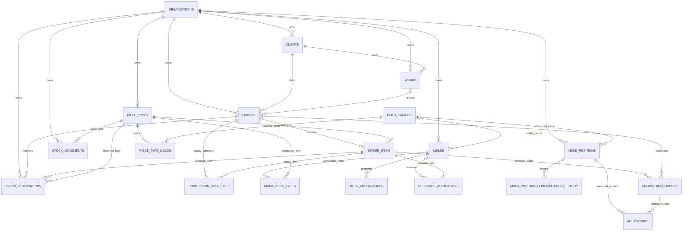

# Modelo PRELUX — obras, pedidos, moldes e produção

Este diagrama descreve as tabelas existentes nas migrações 001–007. A Etapa 5 reaproveita essas estruturas; não recria tabelas nem altera os registros atuais.

O banco também mantém as views `v_piece_inventory`, `v_capacity_daily` e
`v_order_progress` para estoque, capacidade e acompanhamento dos pedidos.

## Chaves, campos e integridade relevantes

- `works`: `id` (PK), `organization_id` (FK), `work_number`, `name`, `client_id` (FK obrigatório), `address`, `start_date` (opcional no esquema atual), `status` e campos operacionais existentes. Os status aceitos são `planejamento`, `ativa`, `concluida` e `cancelada`.
- `orders`: `id` (PK), `organization_id` (FK), `work_id` (FK opcional), `client_id` (FK obrigatório), `order_number`, `start_date` (obrigatório), `requested_due_date`, `status` e campos existentes. O enum atual também contém `concluido`, além de `orcamento`, `aprovado`, `em_producao`, `entregue`, `atrasado` e `cancelado`.
- `order_items`: cada item pertence a um pedido e referencia um `piece_type`; `quantity` é maior que zero. Um pedido deve ter ao menos um item ao ser salvo pela operação existente.
- `piece_types`: catálogo de tipos/modelos. `piece_kind` é `braco`, `pilar` ou `viga`; dimensões X/Y/Z são manuais; `volume_cm3`, `volume_m3` e `weight_kg` são calculados pelo fluxo existente e permanecem inalterados.
- `mold_catalog`: catálogo fixo já existente, com valores de `LEITO`, `LATERAL` e `BRACO`.
- `piece_type_molds`: relação existente que guarda o par escolhido para cada tipo/modelo: um `BRACO` para `braco`, ou um `LEITO` e um `LATERAL` para `pilar`/`viga`. A chave atual permite uma seleção por função (`role`) para cada tipo/modelo.
- `piece_mold_combinations`: view da Etapa 5, sem cópia de dados, que gera três opções fixas de `BRACO` e o produto cartesiano de `LEITO × LATERAL` para `pilar` e `viga`.
- `mold_positions`: quatro posições físicas. Cada posição guarda uma configuração de braço ou um par leito/lateral. `mold_position_configuration_history` preserva as configurações anteriores.
- `production_orders` representa cada unidade planejada de um item, identificada por `unit_sequence`; não existe uma tabela separada chamada `pieces` no esquema atual. `allocations` registra a posição e o dia de concretagem, com no máximo uma alocação ativa por unidade e por posição/dia.
- `production_schedules` é o resumo legado do planejamento. `stock_reservations` e `stock_movements` acompanham estoque de tipos de peça; não representam reserva ou consumo de matérias-primas.

## Regras aplicadas na Etapa 5

- Ao vincular um pedido a uma obra, cliente e data de início vêm da obra. A tela torna esses valores somente leitura; o backend consulta novamente a obra e usa a data cadastrada nela. Se a obra não tiver data de início, o pedido não pode ser salvo até que ela seja informada.
- Sem obra, cliente e data de início continuam sendo informados manualmente.
- A view `piece_mold_combinations` gera as opções a partir de `mold_catalog`: Braço mostra os moldes fixos de braço; Pilar e Viga mostram o produto cartesiano `LEITO × LATERAL`. A escolha é gravada na relação `piece_type_molds` existente.
- Nenhuma fórmula de dimensão é aplicada. Volume e peso continuam seguindo exatamente o cálculo já usado pelo site.
- O setup de posição não muda durante uma concretagem em andamento. O histórico de configuração existente conserva as trocas anteriores.

## Exclusão, RLS e SQL

- Cliente referenciado por obra/pedido usa `ON DELETE RESTRICT`; pedido ligado a obra usa `ON DELETE SET NULL`; itens seguem o ciclo do pedido por `ON DELETE CASCADE`, enquanto tipos de peça referenciados são protegidos por `ON DELETE RESTRICT`.
- As tabelas operacionais têm RLS habilitada sem policies públicas. As Edge Functions usam `service_role` no servidor; a chave administrativa não fica no HTML.
- Para a Etapa 5 descrita aqui não é necessário `CREATE TABLE` nem mudança de coluna: o modelo atual já contém os vínculos necessários. A migração incremental 008 adiciona a view e as regras de herança sem copiar os valores do catálogo.
