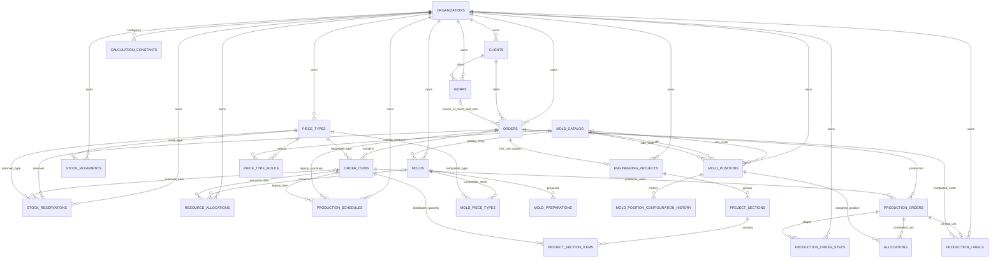

# Modelo PRELUX / Fábio II

O diagrama mantém os nomes das tabelas Supabase atuais (`mold_*` no banco; “forma” na interface). As tabelas de projeto, etapas e etiquetas já fazem parte do projeto Supabase ativo.

## Cardinalidades e integridade

- Uma obra pode ter vários pedidos; um pedido pode não ter obra ou se vincular a uma. Quando há obra, trigger existente herda cliente e data de início. Sem obra, esses campos continuam manuais.
- Um pedido contém itens de catálogo (`order_items → piece_types`). O projeto de engenharia é opcional até a análise e, quando criado, há no máximo um por pedido. Ao salvar o projeto, as seções devem distribuir exatamente a quantidade pedida de cada item.
- `piece_types.piece_kind` contém `braco`, `pilar`, `viga` e `placa`. Braço usa a forma fixa identificada pelas dimensões X × Z; pilar/viga usam LEITO para X, LATERAL para Z e Y como comprimento; placa não usa forma.
- `mold_catalog` continua sendo o catálogo global de medidas LEITO, LATERAL e BRAÇO. Seu `code` e `mold_type` são chaves estáveis; rótulo de medida e ordem de exibição podem ser editados, com bloqueio durante uso ativo e registro em `audit_logs`.
- `piece_type_molds` persiste a seleção compatível para um tipo de peça. `piece_mold_combinations` é uma view sem persistência: lista os braços fixos e o produto cartesiano de LEITO × LATERAL para pilar e viga.
- `mold_positions` representa os quatro espaços físicos P01–P04. Para braço, pilar e viga, o pedido determina os moldes e o planejador associa o item à posição livre. A forma da última concretagem concluída permanece montada até troca ou desmontagem; `form_reset_at` marca a desmontagem. A exceção é a bancada plana, reservada para placa.
- `piece_type_molds` guarda os códigos de catálogo exigidos pelo item. A ligação `production_orders → order_items → piece_types → piece_type_molds → mold_catalog` permite consultar quais formas foram atribuídas a cada unidade e posição. A etapa atual não escolhe um exemplar físico individual por `molds.id`.
- `production_orders` representa uma unidade de um item. Seus horários exatos ficam em `production_order_steps`; `allocations` liga a unidade à posição, registra os códigos da forma em `mold_catalog_codes`, valida os moldes do item e protege a sobreposição de ocupação. Nas novas confirmações, a posição fica reservada desde o início da preparação (se necessária) até o fim da concretagem. A cura de dois dias corridos ocorre fora da posição. Alocações antigas mantêm sua janela histórica.
- `production_schedules` segue como resumo legado. A view `v_order_progress` deriva datas de planejamento de `production_orders`, sem gravar projeções em `orders`.

## Campos e regras da estrutura 009–Etapa 5

`production_order_steps`: `id` (PK), `organization_id` (FK), `production_order_id` (FK composta), `step_kind`, `sequence`, `duration_minutes`, início/fim planejados e reais, status, observação e timestamps. Novas unidades usam cinco dias úteis de preparação quando a forma muda, os minutos de concretagem congelados no pedido, dois dias corridos de cura e um dia útil de acabamento. Linhas antigas de 120 minutos e 12 horas continuam válidas para preservar o histórico.

`calculation_constants`: `id` (PK), `organization_id` (FK), `constant_key`, `numeric_value`, `unit`, `created_at`, `updated_at`; chave única por organização e histórico de alterações em `audit_logs`. Valores semeados: densidade do concreto 2,5 t/m³, início da concretagem às 08:00 no fuso da unidade e valores históricos de concretagem 120 min e cura 12 h. A fila soma a carga de concretagem por dia contra `calendar_days.capacity_minutes`; cura é de dois dias corridos fora da posição e acabamento ocupa um turno útil. O horário inicial é configurável.

`engineering_projects`: `id` (PK), `organization_id` (FK), `order_id` (FK composta, único por organização), timestamps. `project_sections`: `id`, `organization_id`, `project_id` (FK composta), nome e ordem. `project_section_items`: `id`, `organization_id`, `section_id` e `order_item_id` (FKs compostas), quantidade e timestamps. A RPC `save_engineering_project_structure` recebe a divisão completa e grava projeto, seções e itens em uma única transação. Cada item do pedido deve ter a soma de suas quantidades nas seções exatamente igual à quantidade pedida; itens sem distribuição ou com distribuição excedente fazem a transação falhar. Para pedido já projetado, a RPC `save_order_with_project` atualiza pedido, itens e distribuição de seções no mesmo commit.

### Contrato do planejador diário da Etapa 5

Cada unidade da confirmação contém `steps[]` com `stepKind`, `sequence`, `durationMinutes`, `plannedStartAt` e `plannedEndAt`. A preparação, quando necessária, cobre cinco dias úteis; concretagem e acabamento usam a capacidade do dia registrada no calendário; cura dura dois dias corridos fora da posição. Os horários usam `casting_start_hour` e o fuso da organização. `occupiedFromAt` começa no início da preparação ou da concretagem e `occupiedUntilAt` termina com a concretagem. `mold_catalog_codes` preserva a forma da unidade mesmo após editar o catálogo. O banco ainda aceita as janelas históricas.

O cadastro de placa usa a nova RPC `save_plate_type(p_org_id, p_record)` com `code`, `name`, `dimensionXcm` (largura), `dimensionYcm` (altura), `dimensionZcm` (espessura), `productionMinutesPerUnit` e `observations`. O peso confirmado da placa é `largura × altura × espessura × 2,5 t/m³`; as três medidas participam do volume e do peso. A RPC `save_mold_position` mantém o status, as observações e a marca de bancada plana para placas. Para braço, pilar e viga, as formas BRAÇO, LEITO e LATERAL vêm do item do pedido e não ficam vinculadas permanentemente à posição.

## Exclusões, status e cálculos

- As relações pertencentes ao pedido/projeto usam cascata para que itens dependentes não sobrevivam ao pedido; vínculo de cliente em obra/pedido continua protegido por `RESTRICT`; `orders.work_id` continua `SET NULL`.
- O pedido recebe `concluido` automaticamente quando todas as quantidades dos itens estão cobertas por unidades `production_orders` com status `pronta`. Cada unidade fica pronta depois da conclusão de suas etapas de preparação (quando necessária), concretagem, cura e acabamento. Pedidos concluídos permanecem encerrados para replanejamento e alterações de catálogo.
- `production_labels` guarda exatamente uma etiqueta por `production_orders.id` quando o pedido é concluído. O ID, o cliente e o texto impresso são um retrato do pedido no momento da conclusão; RLS impede acesso direto pelo navegador.
- A preparação de forma é calculada com cinco datas úteis inclusivas a partir de `calendar_days`. É necessário gerar o calendário antes de programar a preparação.
- Para braço, pilar e viga, a migration não altera as funções atuais de volume e peso: volume segue X×Y×Z e densidade fixa de 2,5 t/m³. A constante de densidade fica registrada, mas editar esse registro não muda o cálculo legado. Para placa, o peso confirmado é X×Y×Z com densidade fixa de 2,5 t/m³; X×Y é a área e Z é a espessura.
- A fila diária usa um turno de concretagem, dois dias corridos de cura e um turno de acabamento; inspeção e liberação continuam fora dessa previsão até a engenharia definir suas durações.
- Como estimativa de engenharia, a seção retangular fixa de braço representa 218,75 kg/m (25×35 cm), 325 kg/m (25×52 cm) e 450 kg/m (30×60 cm). São contas geométricas usando 2,5 t/m³; confirme a hipótese de seção maciça com a engenharia.

## RLS

As tabelas operacionais e as novas tabelas mantêm RLS ligado sem policies públicas; somente `service_role` tem acesso direto via Edge Functions. Como o site segue sem login, isso não isola usuários ou organizações no endpoint público. O backend precisa manter a organização fixa da PRELUX e validar cada `organization_id`; isolamento multi-organização por usuário depende de autenticação futura.

## Confirmação e concorrência

`factory_plan_revisions` guarda uma revisão por organização. Triggers nas tabelas que alimentam a fila e nas tabelas que recebem reservas incrementam a revisão uma vez por transação. A simulação registra a revisão lida; `commit_factory_simulation` adquire um bloqueio transacional da organização e rejeita cenários desatualizados. A RPC aprova orçamentos selecionados, substitui somente reservas ainda planejadas e grava unidades, etapas, alocações e resumos na mesma transação.

A confirmação é chamada pela Edge Function `confirm-production-plan`. A rota antiga `commit-order-plan` não grava mais alterações. A tabela de revisão e a RPC permanecem exclusivas do `service_role`; não há políticas de escrita para `anon` ou `authenticated`.
