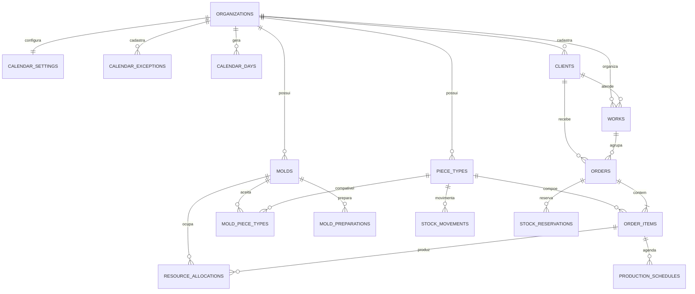

# Diagrama ER — PRELUX

As tabelas `v_piece_inventory`, `v_capacity_daily` e `v_order_progress` são visões de leitura para estoque, ocupação e acompanhamento dos pedidos.

`mold_preparations` registra o checklist e a aprovação de sete dias corridos. `resource_allocations` liga o recurso ao item do pedido e impede sobreposição do mesmo molde; sobreposições em outros recursos exigem justificativa e responsável.
