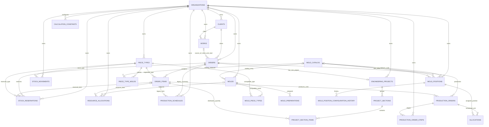

# Modelo PRELUX / Fábio II

O diagrama mantém os nomes das tabelas Supabase atuais (`mold_*` no banco; “forma” na interface). As tabelas de projeto, constantes e etapas são propostas da migration `009_fabio2_foundation.sql`, ainda não aplicada ao projeto Supabase ativo.

## Cardinalidades e integridade

- Uma obra pode ter vários pedidos; um pedido pode não ter obra ou se vincular a uma. Quando há obra, trigger existente herda cliente e data de início. Sem obra, esses campos continuam manuais.
- Um pedido contém itens de catálogo (`order_items → piece_types`). O projeto de engenharia é opcional até a análise e, quando criado, há no máximo um por pedido. Seções distribuem as quantidades dos itens sem exceder o pedido.
- `piece_types.piece_kind` preserva `braco`, `pilar` e `viga`; a migration 009 adiciona `placa`. Braço usa forma fixa; pilar/viga usam pares LEITO × LATERAL; placa usa posição plana sem forma.
- `mold_catalog` continua sendo o catálogo global de medidas LEITO, LATERAL e BRAÇO. Seu `code` e `mold_type` são chaves estáveis; rótulo de medida e ordem de exibição podem ser editados, com bloqueio durante uso ativo e registro em `audit_logs`.
- `piece_type_molds` persiste a seleção compatível para um tipo de peça. `piece_mold_combinations` é uma view sem persistência: lista os braços fixos e o produto cartesiano de LEITO × LATERAL para pilar e viga.
- Uma posição tem uma configuração por vez. A configuração `placa` não tem código de catálogo de forma. Alterações de configuração ficam em `mold_position_configuration_history`, incluindo rótulos de medida guardados para o histórico.
- `production_orders` representa uma unidade de um item. Seus horários exatos ficam em `production_order_steps`; `allocations` liga a unidade à posição e protege a compatibilidade e a sobreposição de ocupação. A nova alocação reserva a posição desde a concretagem até o fim da cura de 12 horas. Linhas antigas sem horários representam o dia todo no fuso da unidade.
- `production_schedules` segue como resumo legado. A view `v_order_progress` deriva datas de planejamento de `production_orders`, sem gravar projeções em `orders`.

## Campos adicionados na proposta 009

`production_order_steps`: `id` (PK), `organization_id` (FK), `production_order_id` (FK composta), `step_kind`, `sequence`, `duration_minutes`, início/fim planejados e reais, status, observação e timestamps. Concretagem e cura têm tempos aprovados de 120 minutos e 12 horas. Durações de acabamento, inspeção e liberação ainda precisam ser fornecidas pela engenharia para calcular a liberação final.

`calculation_constants`: `id` (PK), `organization_id` (FK), `constant_key`, `numeric_value`, `unit`, `created_at`, `updated_at`; chave única por organização e histórico de alterações em `audit_logs`. Valores semeados: densidade do concreto 2,5 t/m³, início da concretagem às 08:00 no fuso da unidade, concretagem 120 min e cura 12 h. O horário inicial de 08:00 é um padrão editável porque o turno da fábrica não foi informado. Os cinco dias úteis de preparação usam o campo existente `molds.preparation_days`.

`engineering_projects`: `id` (PK), `organization_id` (FK), `order_id` (FK composta, único por organização), timestamps. `project_sections`: `id`, `organization_id`, `project_id` (FK composta), nome e ordem. `project_section_items`: `id`, `organization_id`, `section_id` e `order_item_id` (FKs compostas), quantidade e timestamps. A RPC `save_engineering_project_structure` recebe a divisão completa e grava projeto, seções e itens em uma única transação.

### Contrato do planejador para a integração da Etapa 3

Cada unidade enviada a `commit_order_plan` contém `steps[]` com `stepKind`, `sequence`, `durationMinutes`, `plannedStartAt` e `plannedEndAt`. `concretagem` e `cura` são obrigatórias e devem respeitar as constantes (120 e 720 minutos no valor inicial). Acabamento, inspeção e liberação aceitam tempo nulo até a engenharia definir as durações. O horário inicial vem de `casting_start_hour` (padrão editável 08:00) e do fuso da organização. A unidade também envia `occupiedFromAt` e `occupiedUntilAt`; o intervalo cobre concretagem e cura.

O cadastro de placa usa a nova RPC `save_plate_type(p_org_id, p_record)` com `code`, `name`, `dimensionXcm`, `dimensionYcm`, `dimensionZcm`, `productionMinutesPerUnit` e `observations`. A configuração de posição usa a RPC existente `save_mold_position`; para placa, `configuration_kind='placa'` e os três códigos de catálogo ficam nulos.

## Exclusões, status e cálculos

- As relações pertencentes ao pedido/projeto usam cascata para que itens dependentes não sobrevivam ao pedido; vínculo de cliente em obra/pedido continua protegido por `RESTRICT`; `orders.work_id` continua `SET NULL`.
- O enum legado continua contendo `concluido`, mas o fluxo e novos valores usam apenas orçamento, aprovado, em produção, entregue, atrasado e cancelado. O `CHECK NOT VALID` preserva pedidos históricos concluídos; um pedido legado precisa receber um status vigente para ser editado. Para bloqueios de catálogo, esses pedidos históricos são tratados como encerrados.
- A preparação de forma é calculada com cinco datas úteis inclusivas a partir de `calendar_days`. É necessário gerar o calendário antes de programar a preparação.
- Para braço, pilar e viga, a migration não altera as funções atuais de volume e peso: volume segue X×Y×Z e densidade fixa de 2,5 t/m³. A constante de densidade fica registrada, mas editar esse registro não muda o cálculo legado. A placa usa X×Y como área, Z como espessura e a mesma densidade fixa de 2,5 t/m³ para calcular o peso.
- Concretagem e cura têm duração definida; acabamento, inspeção e liberação podem permanecer sem duração enquanto a engenharia não fornecer os tempos. Sem esses valores, o sistema não consegue apresentar uma previsão final de liberação.
- Como estimativa de engenharia, a seção retangular fixa de braço representa 218,75 kg/m (25×35 cm), 325 kg/m (25×52 cm) e 450 kg/m (30×60 cm). São contas geométricas usando 2,5 t/m³; confirme a hipótese de seção maciça com a engenharia.

## RLS

As tabelas operacionais e as novas tabelas mantêm RLS ligado sem policies públicas; somente `service_role` tem acesso direto via Edge Functions. Como o site segue sem login, isso não isola usuários ou organizações no endpoint público. O backend precisa manter a organização fixa da PRELUX e validar cada `organization_id`; isolamento multi-organização por usuário depende de autenticação futura.

> O esquema acima descreve a migration 009 em revisão. Não foi aplicado ao Supabase ativo.
