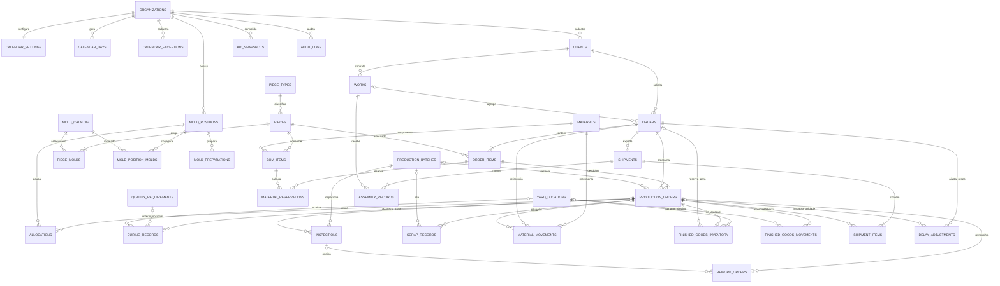

# PRELUX · diagrama ER proposto (Etapa 1)

Este diagrama descreve a proposta isolada em `stage1_schema.sql`. Ele não altera
o banco `public` atual. O tempo de setup permanece sem valor até ser informado.

## Notas de cardinalidade e unidades

- `production_orders` representa uma unidade física. A quantidade do item do
  pedido é desdobrada em N unidades para formar a fila de concretagem e manter
  rastreabilidade individual.
- Uma `allocation` ocupa uma posição de molde em uma data de concretagem. A
  desocupação ocorre após a concretagem; a cura não retém a posição.
- A capacidade do calendário considera somente as quatro posições de molde.
  Central de concreto, equipe e içamento não limitam a programação nesta fase.
- Em Pilar/Viga, LEITO e LATERAL compõem a configuração de uma mesma posição.
  A preparação permanece em sete dias corridos, conforme confirmação do usuário.
  O tempo de setup segue sem duração numérica e não desloca datas até ser definido.
- Uma data inicial não útil é avançada para o próximo dia útil.
- `piece_molds` registra o molde ou conjunto de moldes requerido pela peça.
  A validação de combinação (Braço = BRAÇO; Pilar/Viga = LEITO + LATERAL) fica
  na transação da API e em constraint/trigger no schema público final.
- `production_orders.quality_status` suporta os estados da ficha de
  rastreabilidade consultada: liberada, em reparo e bloqueada.
- `curing_records` guarda os dias de cura usados naquela unidade e a evidência
  de liberação. A resistência mínima não bloqueia a desforma nesta fase; os
  campos ficam opcionais para uso futuro.
- Estoque de materiais e peças prontas é registrado por movimentos e reservas.
  Falta real de material pode impedir a liberação para produção, mas não altera
  o prazo linear. Reprocessos e atrasos são registrados como ajustes manuais.
- A resistência mínima para desforma não bloqueia o fluxo nesta fase, conforme
  orientação do usuário; os campos técnicos permanecem opcionais.
