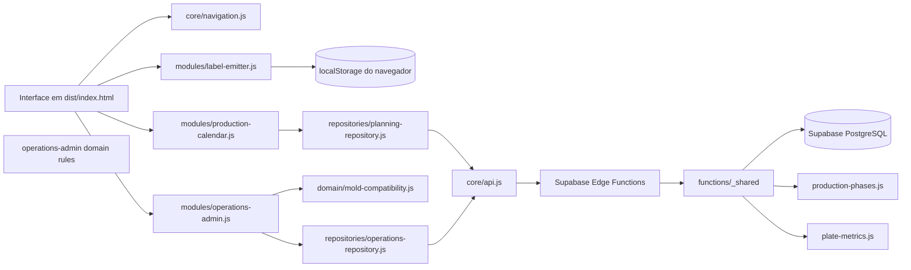

# Como o PRELUX está organizado

Este documento explica o caminho dos dados e a responsabilidade de cada arquivo principal. A aplicação é um **monólito modular**: existe uma única experiência publicada, separada em módulos por área.

## Visão geral

## Arquivos do navegador

| Arquivo | Responsabilidade |
| --- | --- |
| `dist/index.html` | Define as três abas e os elementos da página. Também fornece a configuração pública do Supabase antes de carregar os módulos. |
| `dist/css/app.css` | Estilos gerais, da etiqueta e do calendário. |
| `dist/css/operations.css` | Estilos adicionais dos cadastros e operações. |
| `dist/js/core/navigation.js` | Único lugar que alterna Etiquetas, Planejamento e Cadastros. Atualiza título, acessibilidade e envia eventos para a aba aberta. |
| `dist/js/core/api.js` | Transporte HTTP comum para as Edge Functions e conversão de respostas inválidas em `PreluxApiError`. |
| `dist/js/domain/mold-compatibility.js` | Estratégias puras de escolha de formas: braço usa o catálogo fixo BRACO; pilar e viga usam LEITO × LATERAL. Placa usa uma bancada plana sem forma. |
| `dist/js/repositories/planning-repository.js` | Endpoints de calendário, planejamento e simulação/confirmação dos pedidos. |
| `dist/js/repositories/operations-repository.js` | Endpoints de leitura e gravação de obras, pedidos, projetos de engenharia, peças, formas, posições e alocações. |
| `dist/js/modules/label-emitter.js` | Desenha etiquetas, salva o histórico no navegador, exporta PNG/ZIP e prepara a impressão. |
| `dist/js/modules/production-calendar.js` | Apresenta backlog, calendário mensal/semanal, Gantt e edição da programação. |
| `dist/js/modules/operations-admin.js` | Apresenta obras, pedidos, projetos, peças, formas e posições; mantém o estado da aba interna e envia mudanças ao repositório. |
| `supabase/functions/_shared/production-phases.js` | Regra pura para horários de concretagem, cura e intervalo de ocupação, respeitando o fuso da unidade. |
| `supabase/functions/_shared/plate-metrics.js` | Métricas de placa: X×Y define área, Z define espessura e o peso usa a densidade fixa já aplicada às peças atuais. |

### Ordem de carregamento

O final do `index.html` carrega, nesta ordem: cliente HTTP, emissor, repositórios, regras de compatibilidade, navegação, planejamento e cadastros. Os arquivos são scripts clássicos para manter a aplicação sem compilador; por isso cada módulo publica uma API pequena em `window.PRELUX_*`.

## Fluxos principais

### Etiquetas

O formulário atualiza o canvas. Ao salvar, o registro vai para `localStorage` do navegador, não para a base Supabase. PNG, ZIP e impressão também são processados no navegador. Esse comportamento foi mantido como estava.

### Planejamento e cadastros

1. A tela chama o repositório da sua área.
2. O repositório escolhe a Edge Function e a ação correspondente.
3. `core/api.js` adiciona os cabeçalhos públicos, envia JSON e trata o resultado HTTP.
4. A Edge Function valida a entrada e usa funções de `supabase/functions/_shared`.
5. O backend usa o cliente administrativo do Supabase para persistir no PostgreSQL.

A chave `service_role` permanece no servidor. A chave anônima que existe no HTML é pública e não substitui as políticas de acesso do banco.

### Compatibilidade entre peça e molde

O serviço `mold-compatibility.js` implementa o padrão Strategy. A estratégia depende do tipo selecionado:

- **Braço:** lista apenas registros do catálogo `BRACO`.
- **Pilar e Viga:** lista combinações da view `piece_mold_combinations`; se ela não puder ser carregada, gera LEITO × LATERAL a partir do catálogo já carregado.
- **Placa:** não vincula forma; só é planejada em uma posição `placa`, que representa a bancada plana.

O backend continua validando os vínculos no salvamento. A lista do navegador é para orientar a escolha, não para substituir a validação do servidor.

### Navegação entre módulos

`navigation.js` controla o estado visível das três abas e dispara `prelux:planning:open` ou `prelux:operations:open`. Os módulos escutam esses eventos e atualizam seus próprios dados. Assim, um módulo não precisa importar nem chamar diretamente as funções internas do outro.

## Supabase e regras de negócio

- `supabase/functions/operations-admin/index.ts` atende as operações de cadastro e reutiliza `piece-metrics.js` e `order-planning.js`.
- O mesmo endpoint salva placas via `save_plate_type` e a divisão por seções via `save_engineering_project_structure`; esta gravação é transacional.
- `calendar-admin`, `plan-order`, `commit-order-plan` e `rebuild-calendar` compõem o fluxo de planejamento.
- `planner.js`, `calendar.js`, `order-planning.js`, `piece-metrics.js`, `plate-metrics.js` e `production-phases.js` guardam regras reutilizadas no servidor. Os cálculos existentes de braço, pilar e viga permanecem inalterados.
- As migrações `001` a `008` são históricas; `009_fabio2_foundation.sql` registra a fundação e a integração da Etapa 5 para revisão, sem aplicação no Supabase ativo.
- O status `concluido` não é aceito no fluxo de pedidos; a lista permitida é orçamento, aprovado, em produção, entregue, atrasado e cancelado. Registros antigos permanecem apenas para consulta e são tratados como encerrados.
- A preparação de formas usa cinco dias úteis depois da migration 009; a data final é calculada pelas exceções do calendário.
- O início padrão da concretagem é 08:00 no fuso da unidade e pode ser ajustado em `calculation_constants.casting_start_hour`. Acabamento, inspeção e liberação ficam pendentes até que a engenharia informe as durações.
- A aplicação e a Edge Function foram integradas ao contrato da migration 009, mas a migration não foi aplicada e as funções não foram implantadas no projeto Supabase ativo.

## Cache do aplicativo

`dist/sw.js` lista os arquivos necessários para abrir o app e usa o nome do cache para identificar uma versão. Ao alterar arquivos publicados, atualize os parâmetros de versão no HTML e o nome do cache no service worker; isso faz os navegadores baixarem os arquivos novos.
