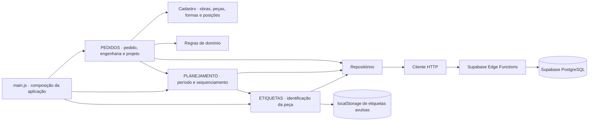

# Arquitetura do PRELUX

O PRELUX é um monólito modular leve: uma PWA estática, sem framework e sem
login na primeira etapa. A interface tem duas áreas de acesso. Os dados e as
regras existentes no Supabase são reaproveitados.

## Dois fluxos relacionados

O trabalho do pedido percorre estas etapas:

```text
PEDIDO → ENGENHARIA → PROJETO → PRODUZIR → ETIQUETAS
```

As áreas do site acompanham a passagem dos dados:

```text
PEDIDOS ↔ PLANEJAMENTO
```

**PEDIDOS** é a entrada do trabalho. Dentro dela ficam pedido, engenharia,
projeto e o subtópico **Cadastro**: obras, peças, catálogo de formas e posições.
**PLANEJAMENTO** apresenta o sequenciamento e os períodos calculados a partir dos
pedidos, respeitando calendário e capacidade. **ETIQUETAS** é a última etapa de
Pedidos e identifica cada unidade após o pedido ser concluído.

## Caminho dos dados



## Organização do navegador

| Caminho | Responsabilidade |
| --- | --- |
| `dist/index.html` | Estrutura das duas áreas e pontos de montagem das telas. |
| `dist/js/main.js` | Composição e inicialização das áreas; abre PEDIDOS ao iniciar. |
| `dist/js/core/api.js` | Envia chamadas HTTP para Edge Functions e normaliza erros. |
| `dist/js/core/navigation.js` | Alterna PEDIDOS e PLANEJAMENTO. |
| `dist/js/domain/mold-compatibility.js` | Lista braço fixo e combinações LEITO × LATERAL para pilar/viga. |
| `dist/js/repositories/` | Contratos de leitura e gravação para pedidos/operações e planejamento. |
| `dist/js/features/operations/index.js` | PEDIDOS, passos de engenharia/projeto e subtópico Cadastro. |
| `dist/js/features/planning/index.js` | Calendário, capacidade, atividades e planejamento de pedidos. |
| `dist/js/features/labels/index.js` | Lista etiquetas de pedidos no Supabase, mantém editor avulso local, prévia, PNG, ZIP e impressão. |
| `supabase/functions/` | Edge Functions e módulos compartilhados do backend. |
| `database/` | Scripts SQL incrementais e diagrama do schema. |

### Inicialização e navegação

1. O navegador carrega `main.js` como módulo ES.
2. `main.js` inicia navegação, etiquetas, planejamento e pedidos.
3. A tela abre em PEDIDOS e carrega os dados pela Edge Function.
4. O fluxo Pedido → Engenharia → Projeto → Produzir → Etiquetas é apresentado
   dentro de PEDIDOS. A conclusão de todas as unidades gera as etiquetas no banco.
5. As telas usam repositórios para chamar o cliente HTTP; não consultam tabelas
   diretamente pelo navegador.

## Responsabilidade das áreas

### PEDIDOS

Recebe e mantém os pedidos. O fluxo visual separa pedido, conferência de
engenharia, distribuição do projeto em seções e entrada na produção. O subtópico
Cadastro mantém as telas de obras, peças, formas e posições dentro desta área.
Os cadastros de catálogo permanecem vinculados às tabelas existentes.

O código atual representa a etapa de engenharia como uma consulta aos itens e
às opções de forma do catálogo. Ela não grava uma decisão de engenharia
separada no banco. O projeto por pedido e a distribuição dos itens usam as
estruturas propostas para a Etapa 5 quando essa migration estiver instalada.

### PLANEJAMENTO

Usa `planningRepository` para consultar calendário, pedidos, posições e etapas,
simular a sequência e gravar o plano pelas operações existentes. O planejador
calcula concretagem e cura; as durações de acabamento, inspeção e liberação
continuam pendentes de definição pela engenharia.

### ETIQUETAS

Ao concluir todas as unidades do pedido, a trigger salva um retrato por unidade
em `production_labels`. A etapa dentro de PEDIDOS lê esses registros pela Edge
Function, desenha o modelo existente em canvas de 1536 × 1024 pixels e permite
baixar PNG, ZIP ou imprimir por pedido. O editor avulso continua manual e seu
histórico fica no `localStorage` do navegador. A caixa **LIBERADA** da etiqueta
continua para conferência manual, separada do status **Pronta** da unidade.

## Acesso sem login na primeira etapa

Não existe tela de autenticação. O navegador usa a configuração pública do
cliente; a chave `service_role` permanece somente nas Edge Functions. A
organização é definida pela configuração do servidor, não por um campo enviado
livremente pelo navegador. Este modelo mantém o escopo atual sem login; não
implementa identidade individual de usuários.

## Banco e publicação

- O schema e os dados do Supabase devem ser reaproveitados; publicar a interface
  não aplica SQL nem publica Edge Functions.
- As migrations até `20261113171705_order_production_labels.sql` estão aplicadas
  no Supabase ativo. Uma instalação nova deve seguir a ordem de `database/README.md`.
- A placa usa os campos existentes `dimension_x_cm`, `dimension_y_cm` e
  `dimension_z_cm`, exibidos como largura, altura e espessura. O cálculo
  automático atual de volume e peso permanece inalterado.
- O catálogo `mold_catalog` continua compartilhado; as formas de braço são
  fixas e as de pilar/viga usam LEITO × LATERAL.
- A PWA é estática e não requer dependências npm para servir. Abra por HTTP com
  `npm start`; abrir o HTML como arquivo não atende módulos ES ou service worker.
- Ao mudar arquivos publicados, avance as versões de cache em `dist/sw.js`,
  `dist/index.html` e `dist/js/main.js` quando aplicável.
