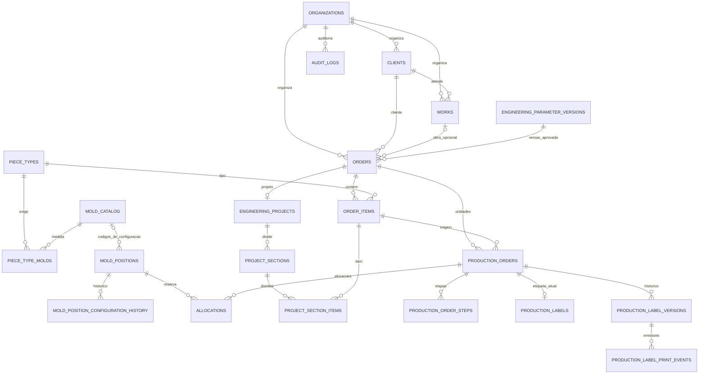

# PRELUX / Fábio II — Etapa 1: inventário atualizado

**Estado:** inventário e proposta para revisão. Não altera a aplicação, o banco
nem os dados.
**Conferido em:** 17/11/2026, usando o repositório local e consultas somente de
leitura ao Supabase ativo.

## 1. Base atual

### Stack

| Parte | O que está em uso |
|---|---|
| Interface | PWA estática em HTML, CSS e JavaScript com módulos ES; sem framework de interface. |
| Publicação | Sites; arquivos publicados em `dist/`, com service worker. |
| Backend | Supabase Edge Functions em TypeScript/Deno e módulos compartilhados JavaScript. |
| Banco | Supabase PostgreSQL. |
| Comunicação | Cliente HTTP e repositórios no navegador; as telas não consultam tabelas diretamente. |
| Verificação local | Node.js e testes nativos; não são dependências do navegador. |
| UI | CSS próprio e SVG inline; não há biblioteca visual instalada nem componente compartilhado `<Icon />`. |
| Identidade | O site continua sem login. RLS está ativada no schema público; a aplicação ainda não identifica perfis de usuários. |

### Interfaces e módulos que já existem

| Interface do briefing | Implementação encontrada | Diferença para o objetivo |
|---|---|---|
| **1. Pedido** | `dist/js/features/operations/index.js`: clientes, obras, pedidos, itens e cadastros. | A área PEDIDOS já existe e é a entrada principal. |
| **2. Engenharia** | Etapa interna do fluxo de PEDIDOS; `engineering-admin` consulta configuração, compatibilidade e métricas. | Não há uma área técnica independente com grade, edição versionada de parâmetros e aviso visual de impacto. A escrita de nova versão não está habilitada pela interface. |
| **3. Produção** | Parte da tela de operações: preparação, alocação, etapas, retirada e conclusão. | Não existe quadro móvel independente para P01–P04, leitura de etiqueta por câmera nem atualização em tempo real. |
| **4. Planejamento** | `dist/js/features/planning/index.js`: calendário, fila, simulação e confirmação. | É a segunda área principal atual. A prévia de orçamento não reserva posição; confirmar grava o plano. |
| **5. Etiquetas** | `dist/js/features/labels/index.js`, aberto dentro do fluxo de PEDIDOS. | Já há etiquetas de produção versionadas e registro de solicitações de impressão; ainda não é uma quinta área no menu principal. |

O menu principal atual tem **PEDIDOS** e **PLANEJAMENTO**. Engenharia, Projeto,
Produzir e Etiquetas aparecem como etapas internas de PEDIDOS. O cadastro de
obras, tipos de peça, formas e posições fica dentro de PEDIDOS, conforme a
decisão anterior de não criar uma área de cadastro independente.

O fluxo atual é:

```text
PEDIDO → ENGENHARIA → PROJETO → PRODUZIR → ETIQUETAS
                       ↘ PLANEJAMENTO (simula e confirma a fila)
```

O briefing transforma o shell em cinco áreas selecionáveis. A sugestão é
separar as telas por responsabilidade sem duplicar os repositórios ou as regras
de domínio já existentes.

## 2. Mapa visual de marca e anexos

### Fontes visuais encontradas

- O app tem `dist/icons/icon.svg`, com PRELUX e ETIQUETAS em azul sobre fundo
  azul-marinho. A etiqueta de rastreabilidade existente
  (`dist/assets/PRE_RASTRE.png`) contém a marca PRELUX e o slogan
  “Estruturas Pré-Moldadas”.
- Os cinco anexos desta conversa são referências raster: fundo com dois
  trabalhadores (1536×1024); engrenagem (1261×1247); prancheta com relógio e
  lápis (1312×1199); trabalhador com ferramentas (1261×1247); e uma moldura
  horizontal branca e azul (1536×1024).
- A moldura anexada pode ser referência para Etiquetas, mas ainda não substituí
  o modelo atual. O emissor mantém canvas PNG de 1536×1024 e usa
  `PRE_RASTRE.png` como base.
- Os três símbolos azuis vieram como PNGs, em grades e espessuras diferentes.
  Não há versões claras/escuras em SVG. Para acessibilidade e consistência, a
  proposta é redesenhá-los como SVGs no mesmo sistema de ícones na Etapa 4,
  conservando os PNGs apenas como referência. Isso ainda não foi feito.

### Paleta encontrada no CSS e na marca

| Token atual | Cor | Uso observado |
|---|---:|---|
| `--navy` | `#071B2D` | Fundo escuro e navegação. |
| `--blue` | `#0F6FC1` | Ação principal e links. |
| Azul do SVG do app | `#1681D1` | Marca PRELUX no ícone PWA. |
| `--blue2` | `#DCEEFF` | Realce azul claro. |
| `--ink` | `#142331` | Texto principal. |
| `--muted` | `#647384` | Texto secundário. |
| `--line` | `#D7E1EA` | Contornos e divisórias. |
| `--bg` | `#F3F6F9` | Fundo claro atual. |
| `--green` | `#0E8B62` | Sucesso. |
| `--orange` | `#D57916` | Atenção. |
| `--red` | `#C33B42` | Erro/risco. |

Os anexos usam azuis próximos de `#0C4D8F`, `#07509A`, `#10569C` e
`#124F93`; a variação vem dos próprios arquivos raster. Para as telas, a
referência única deve ser os tokens existentes, evitando várias cores de azul
quase iguais.

### Tipografia e tokens ainda ausentes

O CSS atual usa `Inter, ui-sans-serif, system-ui, -apple-system, "Segoe UI"`;
o SVG do app usa Arial. Não há arquivos de fonte no projeto. Sugestão: manter
Inter com fallback de sistema para texto e títulos; usar a fonte monoespaçada
do sistema em números e medidas da Engenharia, sem carregar uma fonte remota.

O CSS não centraliza espaçamentos, raios e tamanhos de ícone como tokens.
Escala 4/8/12/16/24/32 px, raios 8/12/16 px e ícones de 20/24/32 px são
**PROPOSTAS**, não decisões da marca. O token de sombra atual é
`0 18px 45px rgba(10,34,54,.09)`.

### Mapa inicial de ícones

Os nomes abaixo descrevem a proposta de SVG, não arquivos já implementados.

| Uso | Referência disponível | Proposta |
|---|---|---|
| Pedido | Ícone de documento já desenhado no menu. | Documento/pedido. |
| Engenharia | Engrenagem azul anexada. | Engrenagem; redesenhar em SVG. |
| Produção | Trabalhador com ferramentas anexado. | Capacete/fábrica; redesenhar em SVG simplificado. |
| Planejamento | Prancheta com relógio e lápis anexada. | Calendário/prancheta. |
| Etiquetas | Moldura horizontal anexada e etiqueta atual. | Tag/etiqueta; moldura fica no preview, não como ícone. |
| Peça | Sem ícone específico. | **PREMISSA:** caixa/peça. |
| Molde | Engrenagem disponível. | Engrenagem. |
| Cura | Relógio aparece na prancheta. | Temporizador. |
| Inspeção | Prancheta disponível, sem marca de aprovação clara. | **PREMISSA:** prancheta com check. |
| Expedição | Sem ícone específico. | **PREMISSA:** caminhão. |
| Alerta | Sem ícone específico. | **PREMISSA:** triângulo de alerta. |
| Prazo | Relógio disponível. | Relógio. |
| Atraso | Sem ícone específico. | **PREMISSA:** relógio com alerta. |

Para estados, conservar inicialmente os tokens existentes: verde para sucesso,
laranja para atenção e vermelho para atraso/erro, sempre com texto junto. Os
estados e a atribuição final de ícones devem ser compartilhados entre telas;
não devem ser fixados por interface individualmente.

## 3. Contratos e fluxo de dados atual

Todas as telas chamam Edge Functions por HTTP com a chave pública do cliente.
As funções leem e gravam no Supabase com credenciais do servidor. O sistema não
usa `EventSource`, WebSocket ou canal Realtime no navegador; as atualizações
dependem de recarregar/solicitar dados.

| Fluxo | Contrato existente |
|---|---|
| Pedido → Cadastro e itens | `operations-admin`: `bootstrap`, `save_work`, `create_order_header`, `add_order_piece_item`, `save_order`, `save_piece_type`, `save_plate_type`, `save_mold`, `save_position`. |
| Engenharia → compatibilidade e medidas | `engineering-admin`: `get_configuration`, `list_mold_options`, `calculate_piece_metrics`; criação de versão de parâmetros está protegida e não disponível ao visitante sem login. |
| Pedido → Projeto | `operations-admin.save_engineering_project`; projeto, seções e distribuição são gravados em transação e a soma das seções precisa cobrir a quantidade do item. |
| Planejamento → Pedido | `simulate-production` calcula sem reservar; `confirm-production-plan` recalcula no servidor e confirma de forma transacional/idempotente. Orçamentos só reservam capacidade após confirmação. |
| Calendário → Planejamento | `calendar-admin.planning_data`, configurações e atividades de calendário. |
| Produção → status | `operations-admin.complete_production_step`; as etapas e triggers atualizam unidade e pedido quando os requisitos são atendidos. |
| Pedido concluído → Etiquetas | Trigger gera uma etiqueta por unidade pronta; a UI lê `production_labels`. Downloads e impressão registrados passam por `record_production_label_prints`. |

A proposta de eventos de domínio pode nomear aprovação, confirmação do plano,
conclusão de etapa, inspeção e solicitação de impressão. Hoje isso não é um
barramento geral: parte do fluxo é transacional por RPC/trigger e parte é
representada por linhas em `production_order_steps` e `audit_logs`. Não
adicionar SSE/WebSocket nem tabela de eventos sem fechar acesso e sem definir
quais eventos serão fonte oficial do estado.

### Contratos ainda ausentes

- Identificação de sessão e autorização por perfil em cada ação.
- Quadro de Produção independente e atualização em tempo real.
- Leitura de etiqueta pela câmera e vínculo com posição.
- Eventos append-only para todos os fatos da produção, inspeção, retrabalho,
  expedição e montagem.
- Lista de materiais por peça e saldo de matéria-prima. As tabelas atuais de
  estoque/reserva representam peças e não uma composição BOM confirmada.
- Contrato de OpenAPI e paginação uniforme para as novas áreas.

## 4. Modelo de dados que já existe

O Supabase ativo possui o histórico até
`20261117144324_label_versions_and_print_audit`; as três migrações mais novas
criaram versões de parâmetros da Engenharia, recibos idempotentes e histórico
de versões/solicitações de etiqueta. Elas **já existem** e não devem ser
recriadas.

Contagens consultadas no banco em 17/11/2026:

| Dados | Quantidade |
|---|---:|
| Clientes / obras | 7 / 3 |
| Catálogo de moldes | 15 medidas |
| Posições | 4: P01–P04; todas disponíveis e sem forma configurada |
| Tipos de peça / vínculos de molde | 1 / 2 |
| Versões de parâmetros de Engenharia | 1 |
| Pedidos / itens / unidades de produção | 0 / 0 / 0 |
| Projetos de Engenharia | 0 |
| Etiquetas atuais / versões / eventos de impressão | 0 / 0 / 0 |

Todas as tabelas de `public` consultadas têm RLS ativada. Isso não cria
perfis: como não há login, o sistema não sabe se a solicitação veio de
Comercial, Engenharia ou Produção.

### Diagrama ER do núcleo existente



### Chaves e comunicação sem duplicar identidade

| Tabela existente | Chave e vínculo principal | Papel |
|---|---|---|
| `works` | PK `id`; FKs para organização e cliente. | Obra; status, início e prazo solicitado. |
| `orders` | PK `id`; `work_id` opcional, `client_id`, versão de Engenharia opcional até aprovação. | Pedido; a trigger herda os dados da obra quando vinculada. |
| `order_items` | PK `id`; FKs para pedido e tipo de peça. | Quantidade, sequência, observação e snapshot de minutos. |
| `piece_types` | PK `id`; código único por organização. | Cadastro de braço, pilar, viga ou placa; dimensões, métricas e tempo. |
| `mold_catalog` | PK `code`; tipos LEITO, LATERAL e BRAÇO. | Medidas do catálogo. Hoje há 7 leitos, 5 laterais e 3 braços. |
| `piece_type_molds` | PK composta `(piece_type_id, role)`; FKs para tipo e código do catálogo. | Requisitos de forma do tipo. |
| `mold_positions` | PK `id`; código único P01–P04; códigos de catálogo são FKs RESTRICT. | Configuração/status da posição física. |
| `engineering_parameter_versions` | PK `id`; versão única por organização. | Parâmetros imutáveis que pedidos aprovados referenciam. |
| `engineering_projects` | PK `id`; único por pedido/organização. | Projeto associado ao pedido. |
| `project_sections` / `project_section_items` | PKs `id`; FKs compostas dentro da organização. | Distribuição dos itens entre seções; soma deve igualar a quantidade. |
| `production_orders` | PK `id`; FKs para pedido e item; uma linha por unidade. | É a identidade atual da peça produzida; não criar uma segunda tabela `pieces` sem necessidade confirmada. |
| `production_order_steps` | PK `id`; FK composta para unidade; sequência única por unidade. | Etapas previstas/reais de preparação, concretagem, cura, acabamento, inspeção e liberação. |
| `allocations` | PK `id`; FKs para unidade e posição; guarda intervalo e snapshot de códigos. | Ocupação planejada/real da posição. |
| `production_labels` | PK `production_order_id`; FK RESTRICT para unidade/pedido e versão corrente. | Retrato atual da etiqueta, uma por unidade. |
| `production_label_versions` | PK composta `(organization_id, production_order_id, version_number)`. | Retratos anteriores da etiqueta. |
| `production_label_print_events` | PK `id`; FK para versão; chave idempotente por unidade. | Solicitação de PNG/ZIP/impressão e nome autodeclarado. |
| `audit_logs` | PK `id`; FK para organização. | Registro de alterações e transições, sem usuário autenticado nesta fase. |

O banco também mantém calendários, exceções, ajustes, revisão global do plano,
recibos de confirmação, estoque/reservas, histórico de configuração de posição,
retiradas e estruturas legadas. As tabelas e dados existentes devem ser
reaproveitados; a etapa não propõe recriá-los.

### Regras efetivas que devem ser preservadas

- Tipos persistidos: braço, pilar, viga e placa. Braço usa molde fixo; pilar e
  viga usam LEITO × LATERAL; placa usa bancada plana, sem forma.
- Para pilar/viga: X = LEITO, Z = LATERAL e Y = comprimento. Para placa:
  X = largura, Y = altura e Z = espessura.
- Volume retangular = X × Y × Z em cm³; volume em m³ divide por 1.000.000;
  peso usa densidade 2.500 kg/m³. A geometria composta foi retirada.
- Configuração da Engenharia já tem versão. Pedido aprovado conserva a versão
  técnica usada; confirmação da fila tem recibo idempotente.
- A configuração ativa usa preparação de 5 dias úteis quando a forma muda;
  concretagem de 1 dia útil; cura de 2 dias corridos fora da posição; e
  acabamento de 1 dia útil. A capacidade é limitada por P01–P04 e pelo
  calendário, até 90 dias.
- Decisão atualizada: manter a regra da versão publicada 44. Se a forma muda,
  a preparação de 5 dias úteis reserva a posição antes da concretagem; os dias
  de preparo não podem coincidir com uma ocupação existente. A cura continua
  fora da posição.
- Uma unidade fica Pronta quando termina as etapas exigidas; o pedido fica
  Concluído quando todas as unidades estão prontas. A caixa LIBERADA da
  etiqueta é manual.
- Decisão recebida nesta revisão: gerar as etiquetas quando o pedido for
  aprovado e a produção iniciar. O comportamento atual gera ao concluir; a
  mudança exige revisar o momento de criação do snapshot e os estados de
  validade das etiquetas.
- `production_minutes_per_unit` é congelado no pedido e agora define a duração
  ativa da concretagem. A fila soma esses minutos por dia contra a capacidade
  do calendário, mantendo limites de posições/concretagens.

## 5. Lacunas planejadas, sem criar tabelas agora

- **Produção como eventos:** não há diário append-only geral; etapas guardam
  estado e horários. Pode ser adicionada quando cada evento e correção forem
  definidos.
- **Qualidade/retrabalho:** há etapa de inspeção no modelo de passos, sem
  regras de aceitação, resistência de desforma ou fluxo de retrabalho definidos.
- **Materiais:** não há BOM confirmada de insumos; estoque atual não deve ser
  tratado como matéria-prima.
- **Expedição/montagem:** não há entidades próprias de embarque e instalação.
- **Cenários:** prévias não são persistidas; o recibo de confirmação já guarda
  a resposta confirmada. Não criar tabela de cada simulação sem decisão.
- **Papéis:** não é possível restringir por função sem identidade/autenticação.
- **Tempo por peça:** cálculo por minuto ativo já aplicado no Supabase; nesta
  continuação, o Planejamento passa a exibir a carga diária e a duração por peça.
- **Scanner e etiqueta:** o sistema gera PNG/ZIP/impressão em 1536×1024; não
  localizei leitura por câmera ou formato de código definido no fluxo.

## 6. Decisões recebidas e pontos em aberto

### Confirmado nesta revisão

- Preparação segue a regra da versão publicada: 5 dias úteis, ocupando a
  posição até o fim da concretagem; não ocorre em paralelo com outra unidade
  na mesma posição. Essa decisão substitui a resposta anterior de adotar o
  briefing que liberava a posição durante o preparo.
- Etiquetas de produção são geradas na aprovação/início da produção.
- A primeira fase continua sem login.
- Interpretei “sim” para catálogo como manter o catálogo editável e incluir
  placa, em linha com a decisão anterior explícita.
- `production_minutes_per_unit` deve influenciar capacidade e datas, não ficar
  apenas como dado informativo.

### Regra confirmada para usar os minutos no planejamento

- `production_minutes_per_unit` representa o tempo ativo de concretagem, não o
  ciclo inteiro. O snapshot é usado para o fim exato da etapa e para somar a
  carga diária da fábrica.
- Cura permanece em dois dias corridos, fora da posição; acabamento ocupa um
  turno no primeiro dia útil após a cura. A preparação da forma continua com a
  regra da versão publicada: cinco dias úteis, posição reservada até terminar
  a concretagem.
- A implementação passou pela suíte local (66 testes aprovados). A migration
  `20261118112946_use_casting_minutes_capacity.sql` foi aplicada ao Supabase
  ativo, e as Edge Functions de simulação, confirmação e compatibilidade foram
  publicadas nas versões 10, 8 e 5, respectivamente, com validação JWT ativa.

## 7. Resultado da Etapa 1

**Feito:** inventário da stack e das cinco interfaces, contratos atuais,
modelo ER baseado no schema ativo, regras de preparo comparadas com a última
versão publicada e divergências registradas. O diagrama não cria tabelas nem
redefine campos existentes.

**Feito nesta continuação:** minutos por unidade integrados à simulação e ao
horário exato da etapa de concretagem, com testes para soma de capacidade,
reservas existentes e tempos separados de cura/acabamento. Dados reais de
qualidade, retrabalho, materiais,
expedição e leitura da etiqueta serão necessários apenas nas etapas que usam
essas informações.

**Riscos:** implementar autenticação sem decisão muda o acesso da primeira
fase; mudar o gatilho de etiquetas afeta pedidos em andamento. As mudanças de
capacidade estão ativas no backend e a atualização visual foi publicada na
versão 45 do Site.
