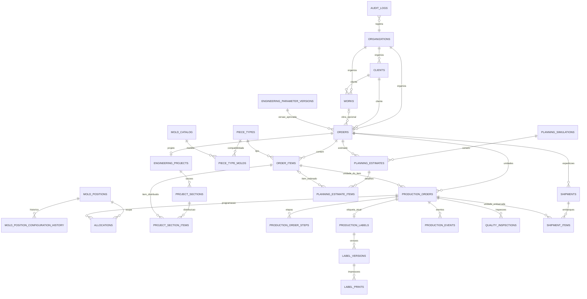

# PRELUX / Fábio II — Etapa 1: inventário e proposta de arquitetura

> Este relatório foi substituído pelo inventário atualizado em
> [`ETAPA1_INVENTARIO_ATUALIZADO.md`](ETAPA1_INVENTARIO_ATUALIZADO.md). Use o
> arquivo atualizado para o schema e os contratos vigentes após as publicações
> de 17/11/2026; este conteúdo é mantido como histórico.

**Estado:** material para revisão. Esta etapa não altera o site, as tabelas nem os dados do Supabase.
**Conferido em:** 17/11/2026, por leitura do repositório e consultas somente de leitura ao Supabase ativo.

## 1. O que existe hoje

### Stack e composição

- **Navegador:** PWA estática em HTML, CSS e JavaScript com módulos ES; sem framework de interface.
- **Hospedagem do site:** Sites. O aplicativo está em `dist/` e usa service worker.
- **Acesso aos dados:** cliente HTTP em `dist/js/core/api.js`; repositórios por domínio; Supabase Edge Functions em TypeScript/Deno; PostgreSQL no Supabase.
- **Ferramentas locais:** Node.js serve o site e executa os testes existentes. Não é dependência do navegador.
- **Autenticação:** não há tela nem sessão de usuário. A aplicação envia a chave pública às Edge Functions; a credencial de serviço fica no servidor. As tabelas têm RLS ligado e não há policies públicas. As RPCs sensíveis conferidas aceitam execução apenas por `service_role`.

### Áreas e módulos atuais

| Módulo atual | Responsabilidade real | Destino proposto |
|---|---|---|
| `dist/js/features/operations/index.js` | Pedidos, obras, itens, projeto/engenharia, formas, posições, registro de produção e ações administrativas | **Pedidos** como entrada; separar os serviços de Engenharia, Projeto e Produção sem reescrever a interface inteira |
| `dist/js/features/planning/index.js` | Calendário, capacidade, simulação da fila, confirmação e ajustes | **Planejamento**; manter como leitura/simulação derivada dos pedidos e operação de confirmar aprovação |
| `dist/js/features/labels/index.js` | Etiquetas gravadas no Supabase e editor avulso no navegador; canvas, PNG, ZIP e impressão | **Etiquetas**; manter o editor e ligar os registros gerados à unidade física |
| `dist/js/domain/mold-compatibility.js` | Compatibilidade de BRAÇO e combinações LEITO × LATERAL | **Engenharia**, como regra de domínio sem acesso a banco ou HTTP |
| `dist/js/repositories/*` e `dist/js/core/api.js` | Contratos de leitura/gravação e transporte HTTP | **Adaptadores de entrada e repositórios** |
| `supabase/functions/_shared/factory-simulator.js` | Simulação da fila em módulo sem acesso ao banco | **Projeto/Planejamento**, mantendo domínio puro |
| `supabase/functions/_shared/*-service.js` | Carregamento de dados, validação e coordenação de gravações | **Serviços de aplicação** |
| `supabase/functions/operations-admin` | Endpoint amplo para cadastros e operações | Manter temporariamente como adaptador; depois mover os casos de uso para módulos menores |
| `calendar-admin`, `simulate-production`, `confirm-production-plan` | Calendário, simulação e confirmação transacional | Manter como contratos atuais durante migração |
| `plan-order`, `commit-order-plan` | Fluxo legado de planejamento | Manter compatibilidade temporária; `commit-order-plan` não deve voltar a gravar o plano |

O fluxo visual documentado e implementado é `Pedido → Engenharia → Projeto → Produzir → Etiquetas`, dentro de **PEDIDOS**, com **PLANEJAMENTO** como área derivada. As telas não consultam o PostgreSQL diretamente.

### Dados reais encontrados no Supabase

Contagens exatas lidas em 17/11/2026; dados existentes devem ser preservados:

| Tabela/conjunto | Registros atuais |
|---|---:|
| `clients` / `works` | 7 clientes / 3 obras |
| `mold_catalog` | 15 medidas |
| `mold_positions` | 4 posições: P01–P04, todas disponíveis |
| `piece_types` / `piece_type_molds` | 1 tipo de peça / 2 vínculos de molde |
| `mold_position_configuration_history` | 2 registros |
| `withdrawn_unit_form_events` | 3 registros históricos |
| `calendar_days` / `audit_logs` | 443 dias / 46 registros |
| `orders`, `order_items`, `production_orders`, `production_order_steps`, `allocations`, `production_labels` | 0 em cada tabela no momento da consulta |
| `engineering_projects`, `project_sections`, `project_section_items` | 0 em cada tabela no momento da consulta |
| `molds`, `stock_movements`, `stock_reservations` | 0 em cada tabela no momento da consulta |

O catálogo contém **LEITO 20, 25, 30, 35, 40, 50, 60 cm; LATERAL 25, 30, 40, 50, 60 cm; BRAÇO 25×35, 25×52, 30×60 cm**. A regra já estabelecida é BRAÇO para braço e LEITO + LATERAL para pilar/viga; X = LEITO, Z = LATERAL e Y = comprimento. Placa usa X = largura, Y = altura, Z = espessura e não exige forma.

O PostgreSQL já possui obras, pedidos, itens, tipos de peça, catálogo, posições, etapas, fila, etiquetas, calendário, ajustes, estoque de peças e auditoria. A lista de migrações ativa do Supabase termina em `20261117123206`; o README também menciona “migration 026”, portanto a numeração documental deve ser reconciliada antes de novas publicações de banco.

### Regras que já estão implementadas ou persistidas

- `orders.work_id` é opcional. A trigger `inherit_order_work_fields` herda cliente e início da obra; `sync_work_fields_to_orders` sincroniza alterações conforme as proteções atuais.
- `order_items` referencia tipos cadastrados e guarda quantidade e ordem. `engineering_projects`, `project_sections` e `project_section_items` dividem a quantidade por seção.
- `production_orders` representa uma unidade do item e hoje é também a identidade persistente da peça para o fluxo de produção e etiqueta. Não existe tabela `pieces` separada.
- `production_order_steps` armazena etapas planejadas/reais. `allocations` liga a unidade a uma posição e guarda um retrato dos códigos do molde. `mold_position_configuration_history` preserva trocas de configuração.
- A confirmação do plano usa revisão concorrente (`factory_plan_revisions`) e RPC transacional `commit_factory_simulation`.
- O simulador compartilhado contém 5 dias úteis de preparação, 1 dia útil de concretagem, 2 dias corridos de cura, 1 dia útil de acabamento e limite de 90 dias. A preparação ocupa a posição se a forma não estiver pronta; concretagem ocupa a posição; cura ocorre fora dela.
- O pedido pode ficar `concluido` quando todas as unidades ficam prontas. `production_labels` é gerada por unidade após a conclusão; a caixa **LIBERADA** permanece uma conferência separada. O editor avulso conserva histórico local no navegador.
- A densidade atual registrada é 2,5 t/m³. Dimensões em centímetros alimentam volume e peso prismáticos; a geometria composta foi removida a pedido anterior.

Há uma divergência técnica a tratar em etapa posterior: `calculation_constants` ainda guarda concretagem de 120 minutos e cura de 12 horas, enquanto o simulador da nova fila usa durações em dias. Existem também caminhos legados que consultam minutos por peça. Não se deve atualizar ou apagar esses valores sem decidir qual contrato ficará como fonte única.

## 2. Lacunas em relação à arquitetura do anexo

| Necessidade do anexo | Situação encontrada | Direção de migração |
|---|---|---|
| `engineering_parameter_versions` | Não existe; `calculation_constants` é mutável e regras do simulador também estão no código | Criar versões imutáveis e associar a versão aprovada ao pedido/plano |
| `mold_catalog` | Já existe com 15 medidas | Reaproveitar; decidir se continua editável com auditoria ou vira catálogo imutável |
| `piece_types` | Já existe, com dimensões, volume/peso, tempos e tipo | Reaproveitar; validar limites e reduzir campos legados só depois de migrar consumidores |
| `pieces` | Não existe; `production_orders` é uma unidade por peça | Reusar `production_orders` como identidade unitária; não criar uma segunda identidade sem necessidade confirmada |
| `piece_molds` | `piece_type_molds` já guarda papéis e códigos; `mold_piece_combinations` expõe combinações; existe também `mold_piece_types` legado | Usar `piece_type_molds` como vínculo canônico e retirar o legado só após migrar as leituras |
| `mold_positions` | Já existe para P01–P04 | Reaproveitar e acrescentar controle otimista de versão se aprovado |
| `planning_simulations`, `planning_estimates`, `planning_estimate_items` | Não existem; prévia é calculada em memória, e a confirmação grava as reservas | Definir se guardar somente cenários confirmados ou também prévias; manter a prévia sem gravação até decisão explícita |
| `production_events` | Não existe; etapa guarda estado/horário atual, sem diário append-only de eventos | Criar eventos idempotentes ligados à unidade e projetar estado nas tabelas atuais |
| `labels`, `label_versions`, `label_prints` | `production_labels` guarda um retrato por unidade; sem versões e sem histórico de impressão no banco | Reusar `production_labels`; acrescentar versões e reimpressões auditáveis, sem apagar a etiqueta anterior |
| `audit_log` | `audit_logs` já existe | Reaproveitar e ampliar os tipos de evento; associar usuário somente quando autenticação existir |
| Materiais e BOM | Estoque atual é de peças acabadas, não matéria-prima | Criar domínio separado de materiais, composição, reserva e movimentação se a reserva de insumos entrar nesta fase |
| Inspeção, retrabalho, expedição e montagem | Não há tabelas próprias | Adicionar entidades e eventos por unidade/lote antes de afirmar rastreabilidade completa |
| Campo `version` | Há revisão global de fila; não há versão individual em pedidos, unidades, posições ou parâmetros | Introduzir versões por registro e comparar a versão esperada em gravações concorrentes |
| Acesso por perfil | Sem login e sem identidade individual | Não é possível aplicar os perfis pedidos de forma segura nesta fase sem definir autenticação/autorização |

## 3. Diagrama de relações proposto

O diagrama distingue tabelas existentes de extensões planejadas. Nomes entre `[]` indicam tabelas novas. `PRODUCTION_ORDERS` é a unidade física equivalente a `pieces`, preservando o identificador já usado pelas etapas, alocações e etiquetas.

**Tabelas existentes** no diagrama: organizações, clientes, obras, pedidos, itens, tipos de peça, catálogo de moldes, compatibilidade, posições, histórico de posição, projeto, seções, itens de seção, unidades (`production_orders`), etapas, alocações, etiquetas atuais e auditoria.

**Tabelas propostas**: versões de parâmetros, simulações/estimativas persistidas conforme decisão, eventos de produção, versões e impressões de etiquetas, inspeções e expedição. O domínio de materiais e montagem também precisa ser modelado se permanecer dentro do escopo. Não criar essas tabelas antes de fechar as perguntas da seção 6.

### Chaves e campos centrais do modelo

As tabelas existentes mantêm suas chaves; esta lista mostra os vínculos que o novo código deve usar, sem recriar tabelas:

| Entidade existente | PK e FKs centrais | Campos que continuam sendo fonte de dados |
|---|---|---|
| `works` | PK `id`; FK `organization_id`, `client_id` | número/nome da obra, endereço, responsável, datas e status |
| `orders` | PK `id`; FK `organization_id`, `work_id` opcional, `client_id` | número, início, prazo, status, observações e vínculo de obra |
| `order_items` | PK `id`; FK `order_id`, `piece_type_id` | quantidade, sequência, observações e snapshot atual de minutos |
| `piece_types` | PK `id`; FK `organization_id`, categoria opcional | tipo, X/Y/Z, volume/peso, duração e campos de cadastro existentes |
| `mold_catalog` | PK/código estável `code` | tipo de catálogo, medida e ordem de exibição |
| `piece_type_molds` | PK composta por tipo e papel; FKs para `piece_types` e `mold_catalog` | código exigido para papel BRAÇO, LEITO ou LATERAL |
| `mold_positions` | PK `id`; códigos de catálogo como FKs | P01–P04, status e configuração atual |
| `production_orders` | PK `id`; FKs compostas para `orders` e `order_items` | unidade, sequência, datas previstas, estado e snapshots |
| `production_order_steps` | PK `id`; FK para `production_orders` | tipo/ordem da etapa, duração, horários previstos/reais e estado |
| `allocations` | PK `id`; FKs para unidade e posição | período ocupado, estado e códigos de forma em snapshot |
| `production_labels` | PK/FK `production_order_id` | etiqueta atual por unidade e texto de identificação congelado |
| `audit_logs` | PK `id`; FK `organization_id` | entidade, ação, rótulo do ator, payload e horário |

As FKs exatas e `ON DELETE` permanecem as do schema ativo. Mudança de FK será proposta apenas se uma necessidade concreta de histórico não puder ser atendida por auditoria/snapshot.

As novas entidades, se aprovadas, terão estes campos mínimos preliminares; detalhes como nomes de estados, retenção e índices serão definidos na migration de cada etapa:

| Nova entidade | PK/FKs e campos mínimos propostos |
|---|---|
| `engineering_parameter_versions` | PK `id`; FK `organization_id`; número de versão único por organização; parâmetros tipados: preparação em dias úteis, concretagem em dias úteis, cura em dias corridos, acabamento em dias úteis, capacidade de concretagens/dia, limite do pedido e início do turno; `created_at`. Linhas imutáveis. |
| `orders` (extensão) | FK opcional `engineering_parameter_version_id`, preenchida ao aprovar; campo `version` para gravação otimista. Não altera os campos atuais do pedido. |
| `production_orders` e `mold_positions` (extensão) | Campo `version` em cada registro para gravação otimista da unidade e da posição. `production_orders` continua a identidade unitária da peça. |
| `planning_simulations` | PK `id`; FK `organization_id`; revisão de fila usada; estado/horários de confirmação e identificador idempotente. Só persistir quando a decisão sobre prévias for fechada. |
| `planning_simulation_orders` | PK composta ou `id`; FKs para simulação e pedido. Necessária porque um cenário contém vários pedidos. |
| `planning_estimates` | PK `id`; FKs para simulação, pedido e versão de parâmetros; datas calculadas, duração e aviso de limite. Um registro por pedido dentro do cenário. |
| `planning_estimate_items` | PK `id`; FK `planning_estimates`, `order_items`; sequência da unidade e etapa, horários planejados, posição e códigos de forma snapshot. Uma linha por unidade/etapa estimada. |
| `production_events` | PK `id`; FK `production_orders`; tipo, instante, payload e chave idempotente; referência de ator fica pendente de login. Eventos não são sobrescritos. |
| `label_versions` | PK `id`; FK da unidade (`production_order_id`); versão única por unidade, snapshot da etiqueta, validade e horário de geração. |
| `label_prints` | PK `id`; FK para versão da etiqueta; horário e resultado da impressão. Identificar com segurança “quem imprimiu” exige autenticação. |
| `quality_inspections` | PK `id`; FK da unidade; instante, resultado e apontamentos. Critérios técnicos não entram até a Engenharia fornecer limites e ensaios. |
| `materials`, `bill_of_materials`, `material_reservations`, `material_movements` | Novas entidades separadas do estoque de peças; FKs ligam material, tipo de peça, pedido/item e movimentação. Quantidades e unidades precisam vir da lista real de insumos. |
| `shipments`, `shipment_items` | Novas entidades; FK da expedição ao pedido e FK do item à unidade física. Detalhes de entrega/montagem ficam para validar com a operação. |

`production_orders` continua sendo a identidade unitária equivalente a `pieces`; criar também `pieces` criaria dois IDs para a mesma unidade. Se for necessário separar cadastro técnico e unidade produzida, isso deve ser aprovado como mudança de modelo, não feito implicitamente.

## 4. Plano incremental de migração

1. **Congelar uma cópia de referência:** exportar schema e dados relevantes; conferir as FKs, checks, RPCs, triggers, policies, permissões e estado das 4 posições. Nenhuma tabela ou dado será apagado nesta reestruturação.
2. **Definir fonte técnica versionada:** criar versões imutáveis dos parâmetros de Engenharia; associar a versão aprovada ao pedido e guardar snapshots de molde/medidas no plano já confirmado. Migrar os valores atuais sem substituir os registros históricos de 120 min/12 h.
3. **Consolidar nomes sem duplicar identidade:** preservar `piece_types`, `mold_catalog`, `piece_type_molds`, `mold_positions`, `orders`, `order_items` e `production_orders`. Tratar `production_orders` como a peça unitária; manter `production_schedules` como compatibilidade até confirmar que nenhum consumidor depende dela. A tabela de compatibilidade legada `mold_piece_types` só sai após a migração de seus leitores.
4. **Persistir versões e estimativas aprovadas:** manter simulação de prévia pura; quando confirmada, registrar snapshot do cenário e versões dos parâmetros, posições e catálogo que produziram a previsão. Uma chave de idempotência evita aprovar duas vezes.
5. **Registrar produção como eventos:** adicionar `production_events` append-only para início/fim de preparação, concretagem, cura, acabamento, inspeção, refugo e retrabalho; atualizar `production_order_steps`/`production_orders` como estado de leitura. Regras de resistência para desforma continuam exigindo dado da Engenharia.
6. **Evoluir etiquetas sem perder a existente:** manter `production_labels` como retrato atual por unidade; adicionar histórico de versões e impressões; não apagar versão invalidada. O gatilho de geração só muda após confirmar o momento de emissão.
7. **Acrescentar materiais e qualidade/expedição em migrações próprias:** matéria-prima nunca será misturada ao estoque atual de peças prontas. Reservas, baixas, inspeções, refugo, carregamento e entrega devem apontar para pedido e unidade rastreável.
8. **Organizar camadas do backend gradualmente:** Edge Functions recebem/validam pedidos, serviços aplicam casos de uso, módulos de domínio calculam sem I/O e repositórios falam com PostgreSQL. Manter os contratos existentes enquanto a interface usa os novos.
9. **Fazer deploy coordenado:** migration aditiva → funções → interface; manter coluna/endpoint antigo durante transição. A Etapa 7 do roteiro do anexo trata testes de integração, segurança e carga; não foi executada nesta etapa.

## 5. Contratos de API para a interface

Os contratos atuais são `POST /functions/v1/<nome>` com JSON, usando a chave pública. A organização é determinada no servidor. As ações abaixo existem no repositório; novas ações ficam condicionadas às decisões pendentes.

| Contrato atual | Uso |
|---|---|
| `operations-admin { action: "bootstrap" }` | Leitura de obras, pedidos, catálogo, posições, projeto, produção e etiquetas |
| `operations-admin { action: "create_order_header" }`, `add_order_piece_item`, `create_order_piece_registration`, `save_order` | Entrada/alteração de pedido e itens |
| `operations-admin { action: "save_engineering_project" }` | Grava projeto e distribuição por seções |
| `operations-admin { action: "save_piece_type" }`, `save_plate_type`, `save_mold`, `save_position` | Cadastros técnicos existentes |
| `simulate-production { orderIds }` | Simula fila sem reservar capacidade |
| `confirm-production-plan { confirmScenario: true, orderIds }` | Recalcula no servidor e aprova/grava reservas em transação |
| `calendar-admin { action: "planning_data" }` | Lê calendário, posições e etapas para Planejamento |
| `operations-admin { action: "complete_production_step", stepId }` | Conclui etapa e atualiza unidade/pedido |
| `operations-admin { action: "delete_record", kind, id }` | Exclusão administrativa com auditoria conforme tipo |

**Contratos novos a detalhar após aprovação do modelo:** leitura de versões e compatibilidades de Engenharia; simulação que retorna datas, ocupação, justificativas e avisos de 90 dias; confirmação idempotente; recebimento idempotente de evento real de produção; geração/versionamento/reimpressão de etiqueta; registro de inspeção e expedição. As telas não devem escrever diretamente em tabelas.

## 6. Divergências que precisam de decisão antes da Etapa 2

O anexo mais recente difere de decisões explícitas já dadas. A recomendação é preservar as decisões anteriores, salvo se você confirmar que quer alterá-las.

1. **Preparação:** a decisão anterior foi cinco dias úteis **ocupando** P01–P04; o novo texto diz que a preparação **não ocupa** a posição. Qual regra usar?
2. **Momento das etiquetas:** a regra anterior foi gerar quando todas as unidades do pedido ficarem Prontas/Concluídas, mantendo “LIBERADA” manual; o novo texto pede geração quando o pedido for aprovado e produção iniciada. Qual evento deve disparar a etiqueta?
3. **Catálogo:** antes foi aprovado manter o catálogo editável com proteção/auditoria; o novo texto o declara fixo e não editável pelo usuário. O catálogo continuará editável pela Engenharia ou será imutável?
4. **Acesso:** antes foi confirmado que a primeira etapa não terá login; o novo texto exige perfis com permissões. Mantemos sem login agora e adiamos perfis, ou esta reestruturação inclui autenticação?
5. **Prévia de planejamento:** o texto pede simulação sem persistência até confirmação e também exige `planning_simulations`. A tabela deve guardar apenas cenários confirmados (recomendado) ou cada prévia simulada?

### Premissas que continuam abertas para etapas posteriores

- O formato final da etiqueta (PDF, código de barras ou QR) continua indefinido; o sistema atual produz PNG/ZIP/impressão.
- O campo de minutos por unidade tem contratos legados que alimentam cadastros/planejador. A escolha entre “somente registro” e “dado usado em cálculo de capacidade” deve ser fechada ao detalhar a versão dos parâmetros.
- Não foi encontrada regra numérica de resistência/liberação para desforma, nem entidades próprias de lote, inspeção, material ou montagem. Não serão inferidos critérios de Engenharia.
- A preparação condicional depende de saber se a posição já contém a mesma forma pronta. O registro explícito de troca/desmontagem deve permanecer como origem desse estado.

## 7. Critério de conclusão da Etapa 1

Concluída a revisão deste inventário, diagrama e migração proposta, e respondidas as cinco divergências acima, a Etapa 1 fica aprovada. Nenhuma migration, teste, alteração de interface ou publicação foi feita nesta etapa. A Etapa 2 só começa depois da aprovação explícita do modelo.
