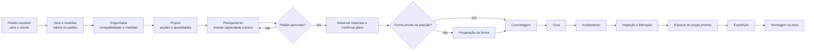
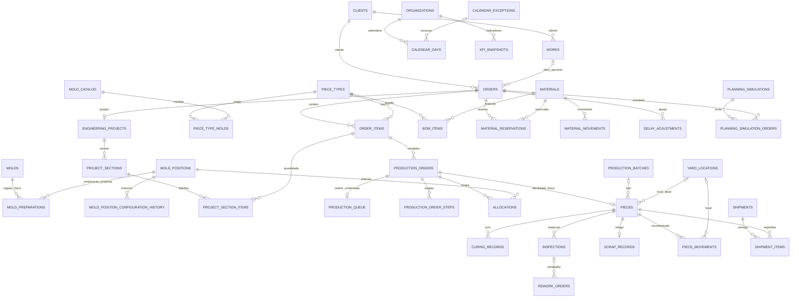

# PRELUX / Fábio II — Etapa 1: processo, arquitetura e modelo de dados

**Estado:** Etapa 1 pronta para revisão. Nenhuma migration ou mudança no site decorre deste documento.
**Base consultada:** texto enviado em 12/11/2026, decisões anteriores desta conversa, migrations `database/001`–`013`, código do planejador e consulta somente leitura ao Supabase ativo em 12/11/2026. Documentos antigos do repositório descrevem versões anteriores e não substituem o esquema consultado.

## 1. Situação real e stack

O aplicativo é um **PWA estático em HTML, CSS e JavaScript com módulos ES, sem framework ou biblioteca de UI**. A interface em `dist/` é publicada no Sites. Os repositórios JavaScript chamam **Supabase Edge Functions**; estas executam regras de servidor e acessam **Supabase PostgreSQL**. Há testes em Node.js, mas Node não é dependência do navegador. A primeira etapa permanece sem login. A área **Etiquetas** desenha PNG em canvas e mantém histórico local no navegador; ainda não cria uma peça física no banco.

O banco ativo já possui **2 obras, 2 pedidos, 1 item, 1 tipo de peça, 15 medidas no catálogo, 4 posições P01–P04, 15 unidades em `production_orders` e 75 registros de etapa**. Esses dados são reais e devem ser preservados. As migrations 008–013 aparecem no histórico ativo. `molds` (exemplares físicos) está vazia; `mold_catalog` contém 7 leitos, 5 laterais e 3 braços. `calendar_days` e as tabelas de projeto, alocação, ajustes e estoque já existem.

Constantes históricas ainda registradas incluem densidade 2,5 t/m³, início da concretagem às 08:00, 120 minutos de concretagem e 12 horas de cura. **Regra operacional confirmada depois:** `production_minutes_per_unit` define a concretagem ativa e seu consumo da capacidade diária; cura de 2 dias corridos e acabamento de 1 dia útil são etapas separadas. Quando a forma muda, preparação ocupa a posição por 5 dias úteis até o fim da concretagem. A migration `20261118112946_use_casting_minutes_capacity` foi aplicada ao Supabase ativo e as Edge Functions de simulação, confirmação e compatibilidade foram atualizadas.

## 2. Mapa do processo

**Origem das regras:** a sequência pedido → planejamento → preparação condicional → concretagem → cura → acabamento → estoque/expedição/montagem vem do anexo. Engenharia, projeto e as três áreas **PEDIDOS, PLANEJAMENTO e ETIQUETAS** vêm das decisões anteriores e da aplicação atual. Inspeção, ensaio e liberação são registros próprios; um prazo de cura, sozinho, não comprova liberação para desforma. Critérios de resistência e normas aplicáveis ainda precisam de validação pela engenharia; nenhum limite estrutural novo é inferido aqui.

No fluxo de entrada, a obra e o tipo de peça podem nascer junto do pedido. O pedido pode começar como orçamento sem itens e receber itens depois. A engenharia confere o vínculo: braço usa um código BRAÇO; pilar/viga usam um par LEITO + LATERAL; X corresponde a LEITO, Z a LATERAL e Y é o comprimento. **Placa permanece no escopo**, com largura X, altura Y e espessura Z, sem forma.

**Calendário e ocupação aprovados:** dias úteis configuráveis e exceções alimentam os 5 dias úteis de preparação, o dia útil de concretagem e o dia útil de acabamento. A preparação ocupa uma das quatro posições durante os cinco dias. A peça sai da posição após a concretagem; a cura de dois dias corridos ocorre fora dela e não bloqueia uma nova concretagem. A forma montada continua pronta na posição para outra peça da mesma configuração até ser desmontada ou trocada. A desmontagem/troca precisa ser registrada para o planejador saber quando aplicar nova preparação.

| Passo operacional do anexo | Suporte atual | Evolução proposta |
|---|---|---|
| 1. Obras e pedidos | `works`, `orders`, `order_items` e formulário de entrada | Recalcular o prazo ao mudar dados, sem exigir peça pré-cadastrada. |
| 2. Peças individuais | `piece_types` guarda o modelo; `production_orders` guarda unidades planejadas | Identidade `pieces` para rastrear a unidade física e ligá-la à etiqueta. |
| 3. Quatro posições | `mold_positions` P01–P04 | Registrar configuração pronta e seus períodos de uso. |
| 4. Ordens de produção | `production_orders` e `production_order_steps` | Confirmar plano com controle de versão/concorrência. |
| 5. Alocação e desalocação | `allocations` | Registrar motivo e horário real da liberação. |
| 6. Lista de materiais | Não há BOM de matéria-prima | `materials` e `bom_items`. |
| 7. Reserva e baixa de materiais | `stock_*` existente trata peças | `material_reservations` e `material_movements`. |
| 8. Preparação | `mold_preparations` exige `molds.id`; não participa plenamente do cálculo | Relacionar preparação à posição/configuração; reservar cinco dias úteis da posição só quando necessária. |
| 9. Produção e cura | Etapas planejadas e alocações; não há ficha física completa | Lote e registros reais de cura por peça. |
| 10. Retrabalho e inspeção | Não há entidades próprias | Inspeções, retrabalho, refugo e impacto no plano. |
| 11. Expedição e montagem | Não há entidades próprias | Cargas, peças embarcadas e confirmação de entrega/montagem. |
| 12. Indicadores | Leituras básicas na interface | Consultas derivadas e snapshots quando houver volume suficiente. |

## 3. Arquitetura proposta

Manter o monólito modular atual, com responsabilidades explícitas:

| Camada | Responsabilidade |
|---|---|
| PEDIDOS no navegador | Receber dados novos, mostrar validações e a sequência Pedido → Engenharia → Projeto → Produzir. Cadastro é subtópico desta área. |
| PLANEJAMENTO no navegador | Exibir fila, calendário, cenários, conflitos e prazo calculado; não criar dados primários do pedido. |
| ETIQUETAS no navegador | Preservar impressão e arquivos atuais; a ligação futura com unidade produzida usa um identificador persistente. |
| Repositórios e `api.js` | Contrato HTTP e tratamento uniforme de erros. |
| Edge Functions | Autorizar a operação, validar entrada, simular e coordenar gravações. |
| Módulo puro de planejamento | Receber um retrato consistente de pedidos, posições, formas, calendário e tempos; devolver datas, ocupações e conflitos sem gravar dados. |
| PostgreSQL | Garantir FKs, checks, unicidade, ausência de sobreposição e gravação atômica do plano confirmado. |

**Simular** não grava dados. **Confirmar** revalida contra o estado atual, grava fila/alocações/reservas numa transação curta e retorna se o cenário mudou. Assim, dois operadores não conseguem confirmar a mesma posição no mesmo intervalo apenas porque ambos viram uma simulação viável. Os índices de FKs e de consultas por período/posição devem ser avaliados sobre os padrões reais de consulta; PostgreSQL não cria índice automaticamente para cada FK.

Sem login, o navegador não recebe `service_role` e não acessa tabelas diretamente. Hoje todas as tabelas `public` consultadas têm RLS ativo e nenhuma policy pública; as Edge Functions concentram o acesso. **Limitação material:** um endpoint público com privilégios de servidor não distingue operadores. Antes de ampliar para reservas, expedição e estoque, a API precisará de limites de uso, validação rigorosa e rastreio confiável da origem; auditoria por usuário e autorização por função exigirão identidade posterior. Referência: [RLS do Supabase](https://supabase.com/docs/guides/database/postgres/row-level-security).

## 4. Modelo lógico: reaproveitar primeiro

`PK` indica chave primária; `FK` indica chave estrangeira; `?` indica opcional. Colunas de auditoria existentes foram omitidas nesta visão para mantê-la legível. Todas as tabelas operacionais existentes têm `organization_id`; os novos registros operacionais seguirão essa chave, enquanto `mold_catalog` permanece global.

| Entidade existente | Chaves e campos principais | Regra/cardinalidade |
|---|---|---|
| `clients` | `id uuid PK`, `organization_id FK`, `name text` | Um cliente tem muitas obras e pedidos. |
| `works` | `id uuid PK`, `client_id FK`, `work_number text?`, `name text`, endereço, responsável, datas, status | Uma obra tem muitos pedidos. |
| `orders` | `id uuid PK`, `work_id FK?`, `client_id FK`, `start_date date`, `requested_due_date date?`, `status order_status` | Pedido com obra herda cliente/início; pode iniciar sem item. |
| `order_items` | `id uuid PK`, `order_id FK`, `piece_type_id FK`, `quantity integer`, `sequence smallint` | Um pedido tem muitos itens; quantidade positiva. |
| `piece_types` | `id uuid PK`, `code text`, `piece_kind text?`, `dimension_x/y/z_cm numeric?`, volume, peso, carga de concretagem | Catálogo de modelo/medida; não equivale a uma unidade física. |
| `mold_catalog` | `code text PK`, `mold_type text`, `measure_label text` | LEITO, LATERAL e BRAÇO; 15 entradas atuais. Não há `name` aqui. |
| `piece_type_molds` | `(piece_type_id, role)` lógico, `catalog_code FK` | Uma seleção BRAÇO ou duas seleções LEITO/LATERAL por tipo/medida. |
| `mold_positions` | `id uuid PK`, `code text`, status, configuração atual opcional | P01–P04; um espaço físico por alocação no intervalo. |
| `mold_preparations` | `id uuid PK`, `mold_id FK`, datas, status, checklist | A estrutura atual aponta a `molds`, que está vazia; precisa de ligação explícita com a posição/configuração quando a preparação entrar no motor. Há zero preparações no banco ativo. |
| `engineering_projects`, `project_sections`, `project_section_items` | `id uuid PK`, FKs para pedido, projeto, seção e item, quantidade | Um projeto por pedido; a soma distribuída de cada item fecha a quantidade pedida. |
| `production_orders` | `id uuid PK`, `order_id FK`, `order_item_id FK`, `unit_sequence integer`, datas e status | Uma linha por unidade planejada do item. |
| `production_order_steps` | `id uuid PK`, `production_order_id FK`, etapa, sequência, horários planejados/reais | Muitas etapas por unidade. |
| `allocations` | `id uuid PK`, `production_order_id FK`, `mold_position_id FK`, intervalo de ocupação | Liga unidade e posição; impedir sobreposição de intervalos ativos. |
| `delay_adjustments` | `id uuid PK`, `order_id FK`, motivo, data, impacto em dias | Ajustes auditáveis; simulação lê os mesmos ajustes. |
| `calendar_days`, `calendar_exceptions`, `calendar_settings` | data/organização ou `id uuid PK`; dia útil e capacidade | Fonte única do calendário. |
| `stock_movements`, `stock_reservations` | FKs para tipo de peça/pedido | Referem-se a **peças**, não substituem estoque de matérias-primas. |

`molds`, `mold_piece_types`, `resource_allocations` e `production_schedules` continuam no esquema por compatibilidade e histórico. A tabela `molds` tem `name` legado, apesar de o anexo dizer que o cadastro não deve solicitar nome. A interface pode identificar a forma por tipo+medida sem apagar a coluna nesta etapa.

## 5. Extensões propostas para os módulos novos

Os campos abaixo são os **mínimos propostos para modelagem**, não colunas aplicadas. `created_at timestamptz` e `organization_id uuid FK` são campos técnicos necessários em registros operacionais, salvo onde a entidade é global. FKs de uma unidade devem ser verificadas também contra a mesma organização. A escolha de `ON DELETE` deve preservar rastreabilidade: cancelar/inativar registros operacionais após produção, em vez de apagar históricos.

| Entidade | Chaves e campos mínimos propostos | Relação e índice principal |
|---|---|---|
| `pieces` | `id uuid PK`, `production_order_id uuid FK UNIQUE`, identificador serial `text UNIQUE`, status | Identidade física de uma unidade para etiqueta, lote, inspeção, estoque e expedição; 1:1 opcional com `production_orders`. |
| `production_queue` | `id uuid PK`, `production_order_id uuid FK UNIQUE`, `queue_rank bigint`, `plan_version integer` | Guarda somente a ordem **confirmada** das unidades; datas, posição e status permanecem em `production_orders`, etapas e alocações. Índice único por organização/versão/posição na fila. |
| `planning_simulations` | `id uuid PK`, `confirmed_at timestamptz`, `scenario_hash text`, `result jsonb` | Apenas cenários **confirmados** são persistidos; simulações temporárias ficam em memória. Para vários pedidos, `planning_simulation_orders(simulation_id FK, order_id FK)` é necessária. |
| `materials` | `id uuid PK`, código e nome `text`, unidade `text`, ativo `boolean` | Novo cadastro indispensável para BOM e estoque de material; código único por organização. |
| `bom_items` | `id uuid PK`, `piece_type_id uuid FK`, `material_id uuid FK`, `quantity_per_unit numeric`, `loss_percent numeric` | Muitos materiais por tipo de peça; chave única por par e versão da ficha, se houver revisão. |
| `material_reservations` | `id uuid PK`, `order_id uuid FK`, `material_id uuid FK`, quantidade `numeric`, status | Reserva ao aprovar; índice por organização/material/status. |
| `material_movements` | `id uuid PK`, `material_id uuid FK`, `order_id uuid FK?`, quantidade `numeric`, tipo, data/hora | Livro de entradas, baixas e perdas; saldo é derivado dos movimentos. |
| `production_batches` | `id uuid PK`, código `text`, data/hora de concretagem, responsável `text?` | Um lote pode reunir várias peças; vínculo `pieces.production_batch_id FK?` seria necessário. |
| `curing_records` | `id uuid PK`, `piece_id uuid FK`, início/fim, método `text?`, resultado de liberação `text?` | Vários registros por peça quando há recura. A resistência/critério de liberação depende de regra aprovada pela engenharia. |
| `inspections` | `id uuid PK`, `piece_id uuid FK`, data, resultado, checklist `jsonb`, responsável `text?` | Histórico de inspeções; fotos exigiriam Storage e tabela de anexos posteriormente. |
| `rework_orders` | `id uuid PK`, `piece_id uuid FK`, `inspection_id uuid FK`, tipo, status, datas | Uma inspeção pode gerar retrabalho; impacto no plano depende da etapa reiniciada. |
| `scrap_records` | `id uuid PK`, `piece_id uuid FK UNIQUE`, motivo, data | Refugo único por peça, com ajuste de estoque e eventual reposição planejada. |
| `yard_locations` | `id uuid PK`, código `text`, descrição `text?`, ativo `boolean` | Local físico; posição atual da peça requer `pieces.yard_location_id FK?` e histórico de movimentação. |
| `piece_movements` | `id uuid PK`, `piece_id uuid FK`, origem/destino `yard_location_id uuid FK?`, tipo `text`, data/hora | Histórico necessário para saber onde a unidade ficou durante cura, estoque e expedição. |
| `shipments` | `id uuid PK`, `work_id uuid FK?`, veículo `text?`, data, destino `text`, status | Uma carga tem várias peças aprovadas. |
| `shipment_items` | `id uuid PK`, `shipment_id uuid FK`, `piece_id uuid FK` | Impedir peça na mesma hora em duas cargas ativas; índice/constraint conforme status da carga. |
| `kpi_snapshots` | `id uuid PK`, período inicial/final, calculado em, indicadores `jsonb` | Cache auditável de BI; os fatos continuam nas tabelas operacionais. |

**Campos adicionais justificados:** `pieces` distingue a unidade física do plano; `materials` fornece a FK que não existe hoje para uma BOM; `planning_simulation_orders` representa múltiplos pedidos por cenário; `piece_movements` mantém o histórico de localização. Nenhum valor de tempo ou limite estrutural é semeado nesta etapa.

## 6. Prazo e capacidade: contrato proposto

Para cada unidade: obter a primeira data útil elegível, localizar posição compatível e livre, reservar cinco dias úteis de preparação **somente se a configuração montada não estiver pronta**, concretar por um dia útil, retirar a peça da posição, contar dois dias corridos de cura fora dela e agendar um dia útil de acabamento. A posição pode receber a próxima concretagem após a concretagem anterior, mantendo a configuração montada. Empates entre pedidos usam aprovação e ordem de entrada do item; será preciso uma chave temporal/ordinal estável para essa ordem, sem depender da ordem casual da consulta SQL.

As dimensões manuais continuam em centímetros. Para a geometria prismática atual, `volume_cm3 = X × Y × Z`, `volume_m3 = volume_cm3 / 1.000.000` e `peso_kg = volume_cm3 × 2,5 / 1.000`. A mesma fórmula vale para placa com X largura, Y altura e Z espessura. Para braço recortado, o volume do prisma externo pode superestimar o concreto; o sistema atual não tem geometria composta e não deve apresentar esse valor como levantamento geométrico validado.

O fim do pedido é o maior fim de acabamento das unidades, sujeito também a inspeção/liberação caso o prazo contratual seja de **entrega pronta**, e não só produção. `dias_corridos = data_fim - data_inicio`. O limite é `data_inicio + 90 dias`; se o fim calculado passar, mostrar excesso em dias. Se houver uma data solicitada anterior ao fim, mostrar a primeira data viável calculada. **Observação matemática:** quando o limite de 90 dias é móvel a partir do próprio início, deslocar o início para mais tarde não resolve, por si só, uma duração maior que 90 dias; a sugestão deve ser redução de carga, capacidade alternativa ou negociação do prazo. Para uma data fixa de entrega do cliente, pode-se calcular por busca a última data de início viável.

Quatro posições não significam sempre quatro concretagens: calendário, manutenção, preparação, configuração compatível e intervalos existentes podem reduzir a capacidade. Ajustes de atraso com motivo, data e impacto existem em `delay_adjustments`; devem entrar no retrato da simulação sem modificar os fatos originais. O valor “4 dias sem preparação” do anexo descreve **dias de etapas**; por exemplo, concretar na segunda e acabar na quinta dá quatro dias contados inclusivamente, mas `quinta - segunda = 3` dias corridos. A interface não deve misturar essas duas contagens.

## 7. Integridade, índices e migração

- Preservar `orders.work_id` opcional e herança de cliente/início. Não recriar `clients`, `works`, `orders`, `order_items`, calendário, catálogo ou posição.
- Para usar `mold_preparations` com o catálogo atual, propor `mold_position_id uuid FK`, tipo de configuração e códigos BRAÇO ou LEITO/LATERAL com checks de formato; tornar `mold_id` opcional para não exigir um exemplar físico inexistente. O período de cinco dias úteis fica vinculado à posição. Como hoje há zero preparações, a mudança não exige converter linhas dessa tabela, mas os 15 intervalos de alocação existentes precisam ser preservados e verificados contra a nova regra.
- Manter o catálogo atual **editável com proteção**: restringir alteração/exclusão de medida usada por peça ou plano e auditar alterações. Preservar os 15 códigos existentes e o histórico de configuração de posição. Não criar campo “nome” na interface do catálogo.
- Manter `placa` como tipo permitido e `concluido` fora dos novos status de pedido; o valor legado do enum e qualquer registro histórico devem ser preservados até uma migração segura.
- Validar `quantity > 0`, dimensões positivas, medidas compatíveis e referência à mesma organização. Para posições, impedir intervalos ativos sobrepostos; confirmação do plano deve ser transacional e resistente a concorrência.
- Indexar FKs e caminhos de leitura: `orders(organization_id, status, created_at)`, `order_items(order_id, sequence)`, `production_orders(order_id, planned_cast_date)`, `allocations(mold_position_id, occupied_from_at, occupied_until_at)`, movimentos por material/data e inspeções por peça/data. Conferir índices já existentes e planos de consulta antes de criar novos.
- Cada nova tabela exposta em `public` terá RLS ativado; sem login, nenhuma policy de escrita direta para `anon`. A Edge Function decide a organização no servidor. Evitar duplicar dados calculáveis, exceto snapshots explícitos para auditoria e desempenho.
- Fazer migrações incrementais após aprovação das regras; primeiro verificar dados históricos, depois `NOT VALID`/validação gradual onde couber, e manter rollback de aplicação. Os dois pedidos existentes não podem ser descartados.

## 8. Divergências resolvidas nesta conversa

1. **Preparação:** manter cinco dias **úteis**, ocupando P01–P04 até a concretagem, conforme a versão publicada.
2. **Escopo de peça/catálogo:** manter **placa** com três dimensões e o catálogo atual editável com proteção.
3. **Durações:** usar os minutos cadastrados por tipo de peça para a concretagem ativa e para calcular capacidade e horário final. Cura continua em dois dias corridos e acabamento em um dia útil; preparação continua com cinco dias úteis quando a forma mudar. Os registros históricos de 120 min/12 h permanecem preservados; uma migration local integra a regra nova.
4. **Ocupação durante a cura:** liberar P01–P04 após a concretagem; a cura ocorre fora da posição. O banco e o código atuais reservam até o fim da cura e precisarão mudar juntos.
5. **Status de pedido:** manter **sem “Concluído”** no fluxo novo. O enum legado contém o valor, mas a constraint já impede novos usos.

**PREMISSAS ainda abertas para desenho detalhado:** como registrar a desmontagem da forma pronta; capacidade física do pátio de cura/estoque; quais etapas um retrabalho reinicia; se a data contratual de entrega depende de inspeção, expedição ou montagem; critério de resistência para desforma. Os minutos de concretagem devem ser mantidos no cadastro de cada tipo com base na rotina real da fábrica; não substituí-los por um valor universal.

## 9. Verificação desta etapa e próximo passo

Esta etapa foi verificada por leitura do histórico de migrations, das tabelas/constraints do Supabase ativo, do código de planejamento e dos documentos do repositório. **Não houve DDL, escrita de dados, alteração de Edge Function ou publicação do site.** Após a revisão deste modelo, a Etapa 2 pode implementar o motor puro, o contrato de confirmação transacional e os casos de teste pedidos no anexo. Antes de gerar SQL, revisar o diagrama contra as FKs reais e o impacto sobre os dois pedidos existentes.
